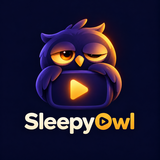
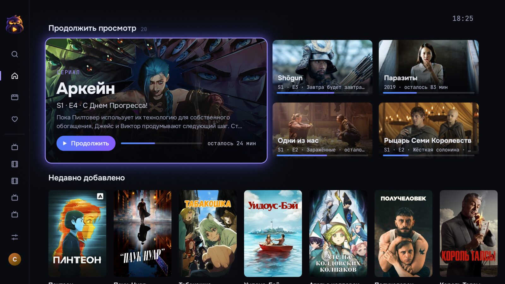
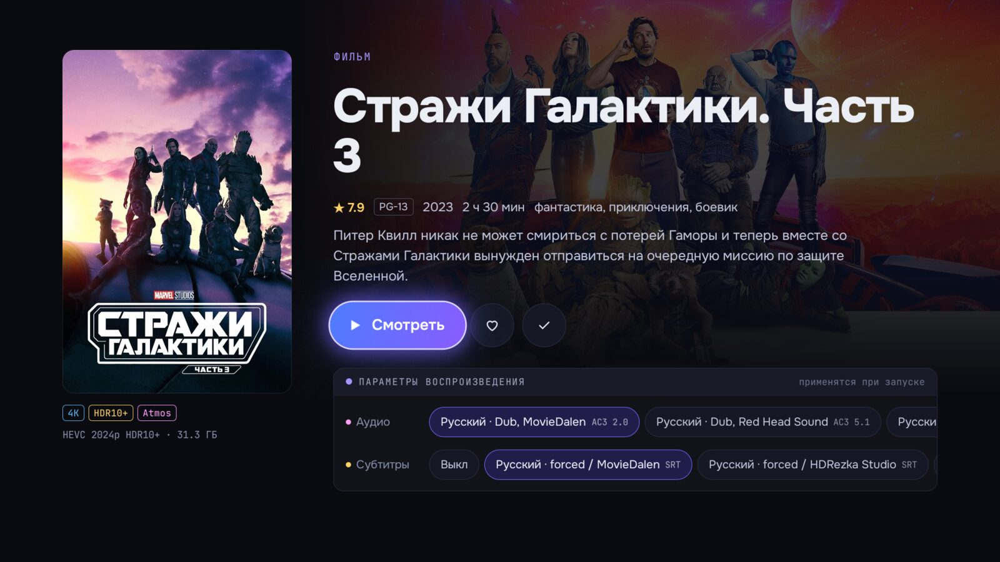
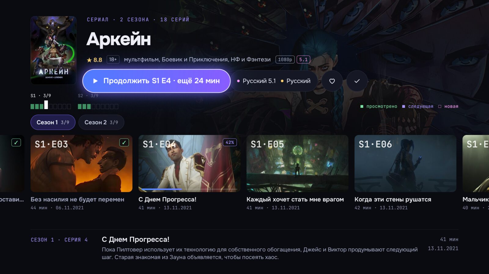
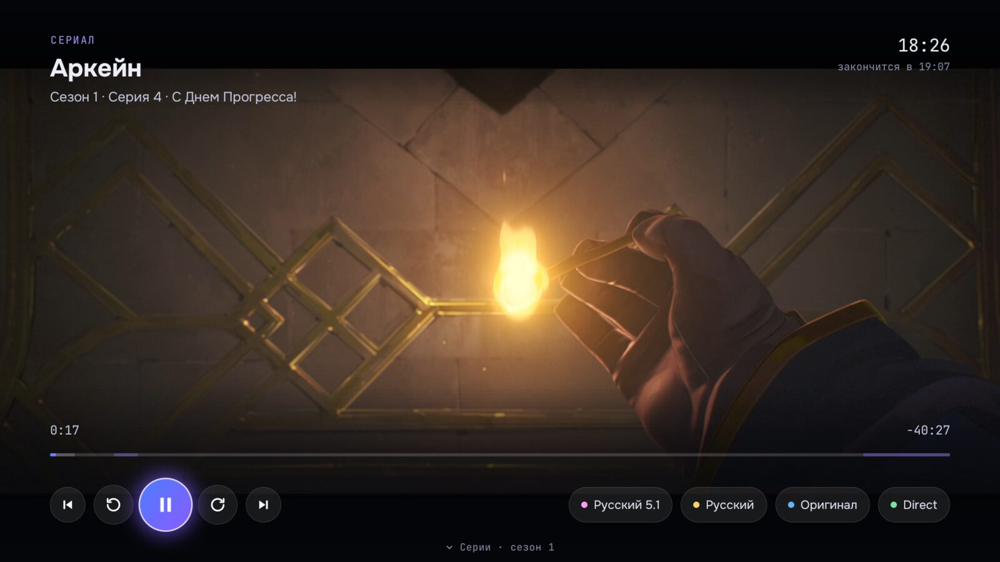
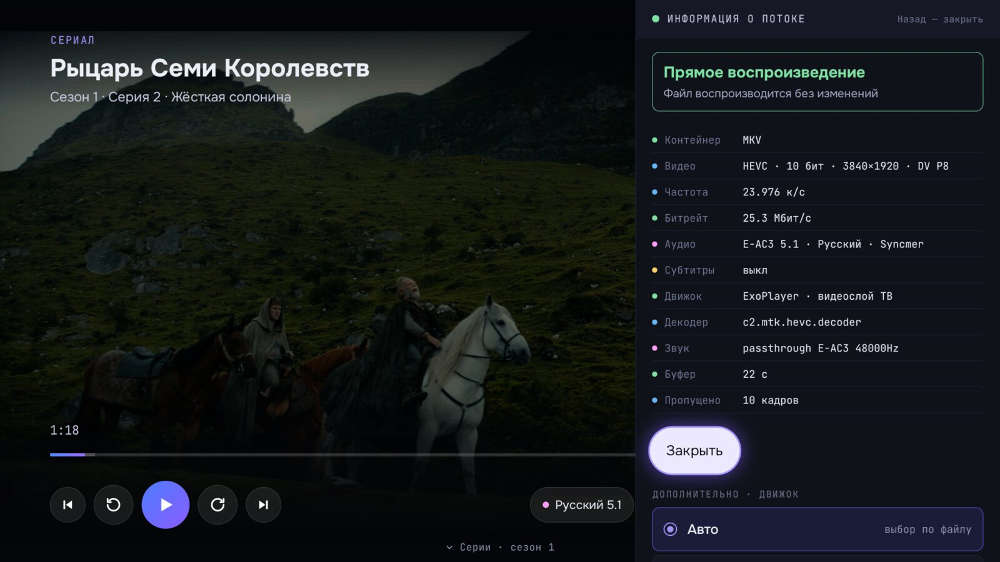
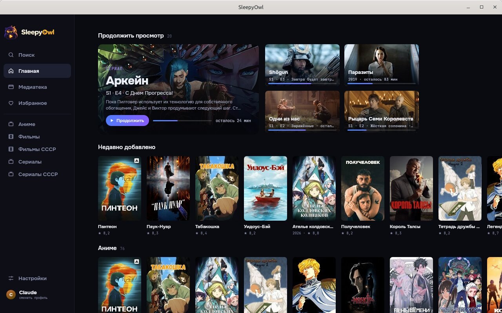

<p align="center">
  
</p>

<h1 align="center">SleepyOwl</h1>

<p align="center">
  Open-source клиент <a href="https://jellyfin.org">Jellyfin</a> для Android TV и Linux на Kotlin.<br>
  Лёгкий и быстрый плеер с простым интерфейсом, рассчитанным на пульт.<br>
  Direct play максимума форматов без серверного транскода, корректный HDR и Dolby Vision.
</p>



## О проекте

SleepyOwl — лёгкий клиент, который быстро работает даже на бюджетных телевизорах. Он разрабатывался и проверялся
на ТВ с 2,4 ГБ памяти, 32-битной системой и слабым GPU. Главный экран открывается сразу из локального снимка и
обновляется в фоне, прокрутка рядов плавная. Интерфейс построен вокруг пульта: боковое меню, крупные карточки,
понятный фокус, минимум вложенных экранов. Озвучка и субтитры выбираются прямо на странице фильма.

Существующие клиенты Jellyfin для Android TV часто уходят в серверный транскод там, где файл можно сыграть напрямую,
показывают HDR и Dolby Vision с неправильной яркостью или зависают на отдельных контейнерах и кодеках.
SleepyOwl решает это гибридным воспроизведением: два движка с разными сильными сторонами, выбор движка под
конкретный файл и автоматический переход на другой движок при сбое.

На тестовой медиатеке из 12 671 файла (MKV/AVI/MP4; HEVC HDR10, Dolby Vision, AV1, H.264 Hi10P, MPEG-2, DivX;
AC3/DTS/TrueHD; ASS/PGS) серверный транскод не понадобился ни разу.

## Возможности

### Воспроизведение на Android TV

- **media3/ExoPlayer** — основной движок: аппаратное декодирование, HDR10, HDR10+, HLG, Dolby Vision,
  passthrough AC3/E-AC3/DTS/TrueHD на ресивер или саундбар.
- **libVLC** — запасной движок на ffmpeg для того, что ExoPlayer не открывает или не декодирует (часть контейнеров,
  программный H.264 Hi10P, VC-1, MPEG-4 ASP и т. п.).
- Движок выбирается до старта по метаданным файла (контейнер, кодеки, битность, профиль DV) и возможностям устройства.
- Если движок упал, завис или не выдал кадр, воспроизведение продолжается на другом движке с той же позиции.
  Серверный транскод — последний вариант.
- Субтитры SRT, ASS (через libass) и PGS; стиль субтитров настраивается.

### Интерфейс на Android TV

- Главная с «Продолжить просмотр», библиотеки, страницы фильмов и сериалов, поиск, избранное, отметка просмотренного.
- Выбор аудио и субтитров до старта; выбранные дорожки запоминаются для фильма или сериала.
- Пропуск заставок и титров по Media Segments (плагин Intro Skipper), автопереход к следующей серии.
- Вход по Quick Connect (QR-код) или паролю, несколько профилей.
- Интерфейс оптимизирован под слабые GPU телевизоров (тестовое устройство — Xiaomi TV S Pro на MediaTek MT9689).

### Linux

- Воспроизведение через libmpv, видео рисуется прямо в окне Compose вместе с OSD.
- Три режима плеера, переключаются без остановки видео: мини-окно поверх остальных окон (можно двигать
  и масштабировать с сохранением пропорций), обычное окно, полный экран.
- MPRIS (медиаклавиши, апплет плеера в панели), запрет скринсейвера во время просмотра.
- Пакет `.deb` со встроенной JRE.
- HDR на ПК выводится как SDR.

## Скриншоты

<table>
  <tr>
    <td></td>
    <td></td>
  </tr>
  <tr>
    <td align="center">Страница фильма, выбор дорожек</td>
    <td align="center">Страница сериала</td>
  </tr>
  <tr>
    <td></td>
    <td></td>
  </tr>
  <tr>
    <td align="center">Плеер</td>
    <td align="center">Информация о потоке: 4K HEVC Dolby Vision, direct play, passthrough E-AC3</td>
  </tr>
  <tr>
    <td colspan="2"></td>
  </tr>
  <tr>
    <td colspan="2" align="center">Linux: окно медиатеки</td>
  </tr>
</table>

## Установка

Сборки публикуются на странице **Releases**:

| Платформа | Файл | Требования |
|---|---|---|
| Android TV | `sleepyowl-<версия>.apk` | Android 8.0+, `armeabi-v7a` или `arm64-v8a` |
| Linux | `sleepyowl_<версия>_amd64.deb` | Ubuntu 24.04 / Linux Mint 22 или новее (`libmpv2`), X11 или XWayland |

```sh
# Android TV, через adb
adb install sleepyowl-<версия>.apk

# Linux
sudo apt install ./sleepyowl_<версия>_amd64.deb
```

Сервер: Jellyfin 12.x.

## Сборка

Нужны JDK 21 и Android SDK.

```sh
./gradlew :app:assembleRelease     # APK для Android TV
./gradlew :desktop:run             # запуск версии для Linux
./gradlew :desktop:packageDeb      # пакет .deb
./gradlew test
```

Подробности — в [docs/development.md](docs/development.md).

## Стек

Kotlin, Jetpack Compose / Compose Multiplatform, Navigation 3, Koin, Coil 3, jellyfin-sdk-kotlin, media3, libVLC,
libass, libmpv (JNA), OkHttp, DataStore. Общий код (данные, работа с сервером, логика воспроизведения, view models)
вынесен в модули Kotlin Multiplatform для Android и десктопа.

## Документация

Архитектура, решения по воспроизведению, найденные проблемы и способы их обхода — в [docs/](docs/README.md).

## Лицензия

[GPL-3.0-or-later](https://www.gnu.org/licenses/gpl-3.0.html). Проект не связан с командой Jellyfin.
